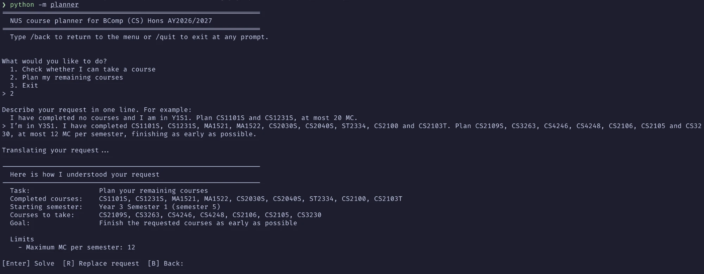
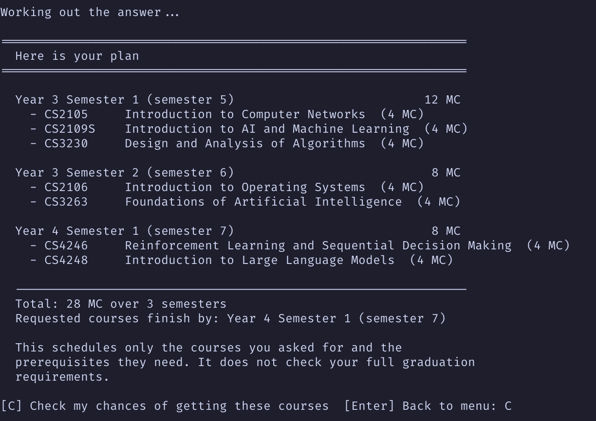
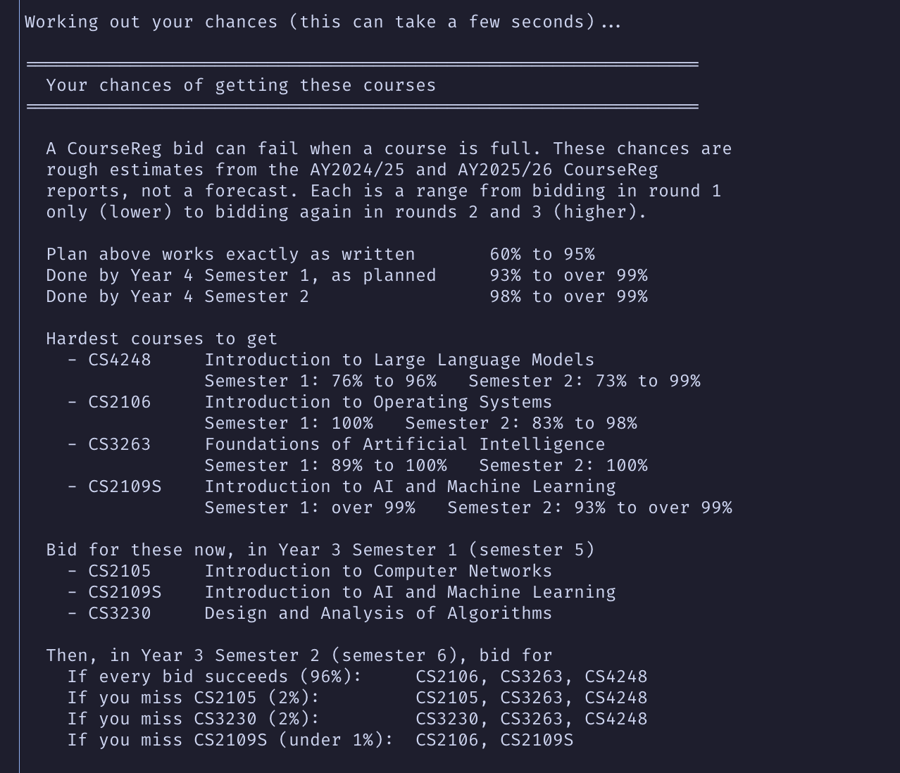
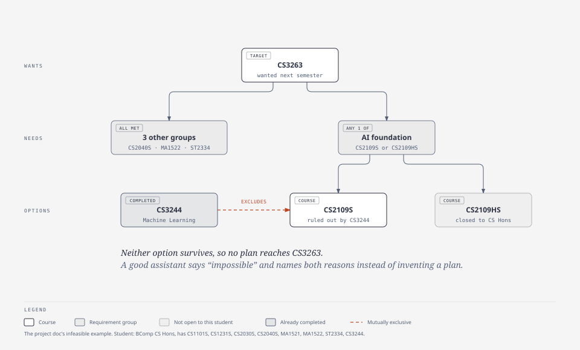

# LLM vs Solver for NUS Degree Plans

This repo compares two ways of answering NUS degree-planning questions with a frontier LLM. In pipeline A the
LLM answers the question itself. In pipeline B the same LLM translates the question into a JSON spec, and a
CP-SAT constraint solver answers the spec. The experiment measures where each approach goes wrong, including on
requests that have no valid plan.

The two questions are Q1, "can I take this course?", and Q2, "plan my remaining semesters". Everything covers
BComp (CS) Hons, single major, under NUSMods AY2026/27 data. Requests about DDPs, second majors, minors or other
programmes get `OUT_OF_SCOPE` with a reason.

## Setup

Python 3.10+. From the repo root:

```bash
python -m pip install -r requirements-dev.txt
cp .env.example .env    # then set LLM_BASE_URL, LLM_API_KEY and LLM_MODEL (any OpenAI-compatible API)
```

The LLM settings are needed for the eligibility checker and planner, and for real pipeline runs. `.env` is Git-ignored, and variables
already set in your environment take priority over it.

## Eligibility checker and planner

This interactive command-line tool is the main way to use the project. It answers both questions in plain English:

- **Check a course:** "I have completed CS1101S, CS1231S, CS2030S and CS2040S and I am in Y2S1. Can I take CS3230
  next semester?" You get yes or no, the reasons, and whether the course is ruled out for good.
- **Plan your courses:** "I'm in Y3S1 ... Plan CS2109S, CS3263 and CS4248, at most 12 MC per semester." You get a
  semester-by-semester plan, or the rules that make a plan impossible.

```bash
python -m planner
```

Pick a task from the menu, then describe the request in one line. The LLM translates it into a spec (pipeline B),
and the tool shows how it understood the request before anything is solved. If something required is missing, such
as your completed courses, it asks. We show a planning request example in the following:



The solver then answers. A plan lists each semester's courses with titles and MC:



A plan covers the courses you name and the prerequisites they need.

After a plan, `C` checks your chances of getting its courses in CourseReg based on past module allocation data published. The bidding MDP (see
[How it works](#how-it-works)) gives a range for each chance, the courses that are hardest to get, what to bid for
now, and what to bid for next semester if a bid fails:



The full walkthrough for both tasks, with every key and what each part of an answer means, is in
[CHECKER_PLANNER_GUIDE.md](docs/CHECKER_PLANNER_GUIDE.md).

## Other ways in

**Run the solver on a spec.**

```bash
python -m solver.run examples/q1_eligible.json
python -m solver.run examples/q2_plan.json
```

```python
from solver.run import run
answer = run({"query": "eligible", "target": "CS3263", "current_sem": 5,
              "completed": ["CS1101S", "CS1231S", "CS2030S", "CS2040S", "MA1521", "MA1522", "ST2334"]})
# {"status": "NOT_ELIGIBLE", "reasons": ["missing prerequisite: CS2109S or CS2109HS"], ...}
```

**Look up a course.** Open `data/processed/AY2026-2027/COURSES.md` and search for `### CS3263`, browse the
per-course diagrams from `data/processed/AY2026-2027/diagrams/index.html`, or load the catalogue in Python:

```python
from m1_data.catalog import Catalog
cat = Catalog.load()
cat.can_take("CS3263", {"CS2040S", "MA1521", "MA1522", "ST2334"})
# (False, ['missing prerequisite: CS2109S or CS2109HS'])
```

If GitHub Pages is turned on for the repo (Settings → Pages → Deploy from a branch → `main` / root), the diagrams
are also at `https://zsyuyiie.github.io/cs3263-project/data/processed/AY2026-2027/diagrams/index.html`.

## How it works



**Course data** (`m1_data/`). NUSMods gives prerequisites and preclusions as rule strings mixed with programme,
cohort and A-level conditions. The pipeline resolves those conditions for a BComp CS Hons student and writes
course-only logic trees to `data/processed/AY2026-2027/catalog.json`, cross-checked against NUSMods' own
prerequisite trees. The processed data is committed. To rebuild it, run `python -m m1_data fetch` and then
`python -m m1_data build`. Fields and interpretation decisions: [DATA_SCHEMA.md](docs/DATA_SCHEMA.md).

**Solver** (`solver/`). Q1 evaluates the course's prerequisite and preclusion trees against the student's
transcript. Q2 is a CP-SAT model with 11 hard rules (prerequisites, offering terms, exclusions, MC caps, ATAP and
others), optimised in stages: the objective, then the fewest added courses, then the most preferences met. When
no plan exists, `solver/explain.py` names a minimal set of rules that conflict. A hand-written backtracking solver
(`solver/backtrack.py`, four variants from plain search to MAC) solves the same problem for an ablation and must
reach the same optimum. Spec fields, answers and rules: [SOLVER_GUIDE.md](docs/SOLVER_GUIDE.md).

**Bidding** (`solver/mdp.py`). A CP-SAT plan assumes every CourseReg bid succeeds. The MDP extension estimates the
chance of getting each course from two years of CourseReg allocation reports and returns a bidding policy instead
of a fixed plan. On the 45 test requests that have a plan, the chance of finishing by semester 8 rises from 0.947
for the plan as written to 0.992 for the policy (all-rounds scenario), and from 0.690 to 0.904 under the
round-1-only scenario. Details: [MDP_GUIDE.md](docs/MDP_GUIDE.md).

## Run the experiment

Each instance is a natural-language request generated from a gold spec, with the solver's answer as the gold
answer. `instances/instances.json` has 115 mixed requests (Q1, feasible and infeasible Q2, missing information,
out of scope), and `instances/q1_400.json` has 400 Q1 requests. Both are generated, so don't edit them by hand.

```bash
python -m pipelines.run_a --mock gold      # dry run with no API: every answer is the gold answer
python -m pipelines.run_a                  # pipeline A  -> results/A/<model>/
python -m pipelines.run_b                  # pipeline B  -> results/B/<model>/
python -m eval.grade results/A/<model> results/B/<model>
```

`eval/checker.py` checks every plan against the hard rules on its own, without importing the solver.
`eval/grade.py` sorts each answer into a class (optimal, preference gap, extra courses, objective gap, invalid,
over-refusal, invented plan) and writes `graded.csv`, `SUMMARY.md` and `COMPARE.md`. Options, other instance
sets and the prompt ablation: [pipelines/README.md](pipelines/README.md).

## Docs and layout

| Doc | What it covers |
| --- | --- |
| [CHECKER_PLANNER_GUIDE.md](docs/CHECKER_PLANNER_GUIDE.md) | using the eligibility checker and planner: requests, keys, answers, chances |
| [CODE_GUIDE.md](docs/CODE_GUIDE.md) | how the code fits together, following one request through it (start here) |
| [FORMULATION.md](docs/FORMULATION.md) | the whole problem formulation on one page |
| [DATA_SCHEMA.md](docs/DATA_SCHEMA.md) | the catalogue format and how the NUSMods rules were read |
| [SOLVER_GUIDE.md](docs/SOLVER_GUIDE.md) | spec fields, answers, hard rules, optimality, the backtracking variants |
| [TRANSLATION_GUIDE.md](docs/TRANSLATION_GUIDE.md) | how pipeline B turns a request into a spec, and how that is scored |
| [MDP_GUIDE.md](docs/MDP_GUIDE.md) | the bidding extension: formulation, data, results, limits |

```
m1_data/       data pipeline: fetch, parse, resolve, build, check, catalog
solver/        Q1, Q2 (CP-SAT), conflict explanation, backtracking solver, bidding MDP
planner/       eligibility checker and planner (python -m planner)
pipelines/     pipeline A and B prompts and runners
instances/     instance generators and the generated sets
eval/          independent checker and grader
experiments/   ablation and bidding experiments
data/          raw NUSMods data, processed catalogue, CourseReg rows, config and manual fixes
examples/      example specs
tests/         pytest
```

Before pushing, run `ruff check .` and `python -m pytest -q`.
