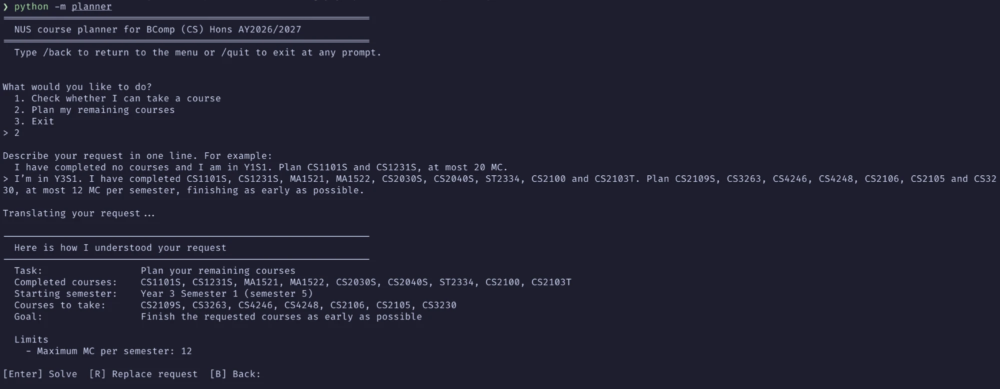
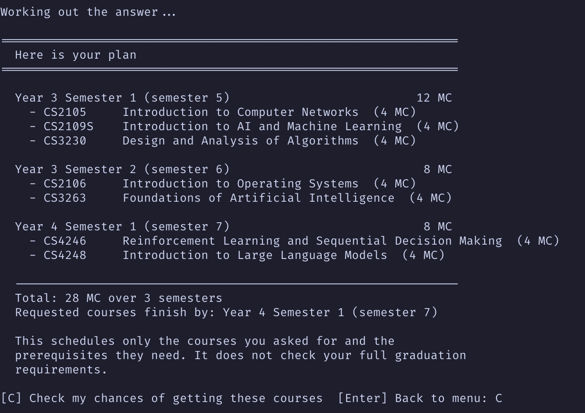
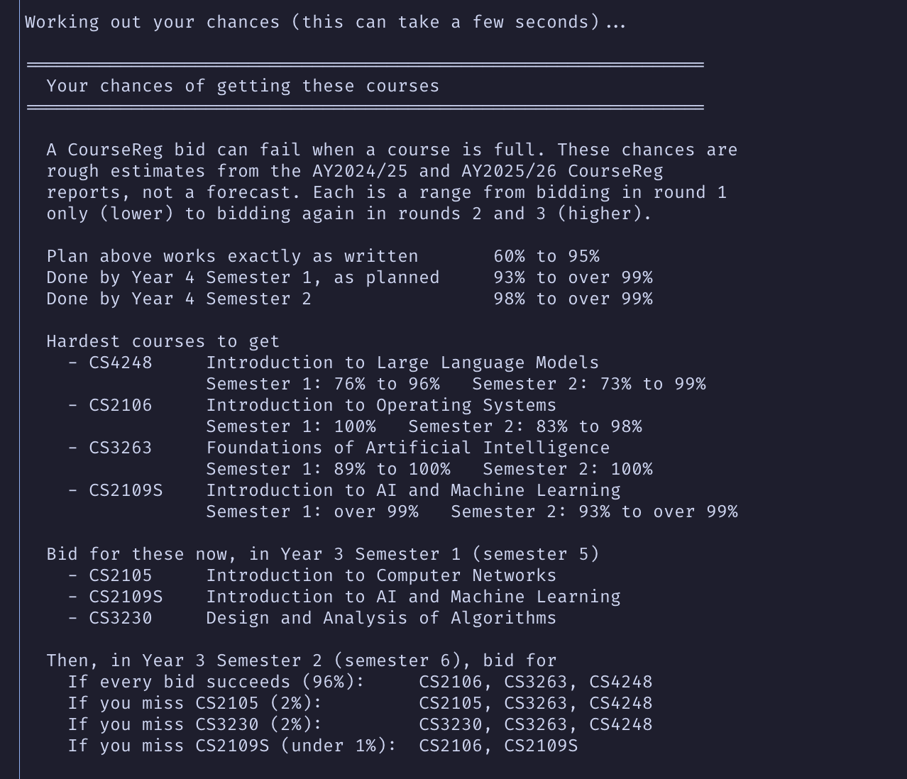

# Eligibility checker and planner guide

`python -m planner` starts the eligibility checker and planner, an interactive command-line tool. It handles
both questions the solver answers:

- **Check a course (Q1):** can I take this course, in a given semester? The answer is yes or no with the reasons,
  and says whether the course is still possible later or ruled out for good.
- **Plan my courses (Q2):** plan my remaining semesters so that I take these courses. The answer is a plan that
  meets every rule, or the smallest set of rules that cannot all hold. After a plan you can also see your chances
  of getting its courses in CourseReg.

For either task you type the request in plain English, the LLM translates it into a spec (pipeline B), you check
that reading, and the solver answers. The tool covers BComp (CS) Hons students, single major, under AY2026/27 rules.
Anyone else gets a refusal that says why.

Contents:

1. Starting it
2. A session, step by step
3. Reading a course check
4. Reading a plan
5. Checking your chances in CourseReg (plans only)
6. Keys and commands
7. Limits
8. Where the code is

## 1. Starting it

From the repo root:

```bash
python -m pip install -r requirements-dev.txt
cp .env.example .env    # first time only
python -m planner
```

Set `LLM_BASE_URL`, `LLM_API_KEY` and `LLM_MODEL` in `.env`; any OpenAI-compatible API works. If one of them is
missing, the tool prints which file to edit and exits. Variables already set in your shell take priority over
`.env`.

| Option | Default | Meaning |
|---|---|---|
| `--timeout N` | 60 | seconds to wait for the LLM on each attempt |
| `--retries N` | 1 | extra attempts after an API error, 0 to 2 |
| `--max-tokens N` | 24576 | longest translation reply allowed |

## 2. A session, step by step

### Choose a task

```
What would you like to do?
  1. Check whether I can take a course
  2. Plan my remaining courses
  3. Exit
```

Option 1 checks one course. Option 2 plans your remaining semesters. The menu prompt then shows an example request
for the task you picked.

### Describe the request

Type the whole request on one line.

For a course check, give what you have completed, the course, and when you want to take it:

> I am in Y2S1 and have done CS1101S, CS1231S, CS2030S and CS2040S. Can I take CS3230 next semester?

The semester is optional. "Next semester" is worked out from the semester you say you are in. Without any semester,
the answer covers both terms and says which ones the course is offered in.

For a plan, give what you have completed, the semester you are in, the courses you want, and any limits or wishes:

> I'm in Y3S1. I have completed CS1101S, CS1231S, MA1521, MA1522, CS2030S, CS2040S, ST2334, CS2100 and CS2103T.
> Plan CS2109S, CS3263, CS4246, CS4248, CS2106, CS2105 and CS3230, at most 12 MC per semester, finishing as early
> as possible.

Things the tool understands in a request:

- Semesters as `Y2S1`, "year 2 semester 1" or a number from 1 to 8 (Y1S1 = 1, Y1S2 = 2, ..., Y4S2 = 8).
- For plans, limits: "at most 12 MC per semester", "at most 3 modules a semester" (4 MC each), "at least 8 MC", "semester 6 is
  my exchange semester" (no courses that semester).
- For plans, ATAP: "I will do ATAP in semester 6", optionally "and take nothing else then".
- For plans, goals: "graduate as early as possible", "fewest total MC".
- For plans, wishes about specific courses: "CS2100 must come before CS2106", "if possible, CS3230 in semester 5", "CS3230 and
  CS4248 in different semesters", "CS2109S as early as possible". Words like *must*, *have to* and *need to* make a
  wish a hard rule; *prefer*, *would like* and *if possible* make it a preference.

Anything the solver cannot model, such as "no 8am classes" or "I might fail CS3263", is kept and shown back to you
as a wish it could not apply. It is never dropped silently. The full list of rules the translation follows is in
[TRANSLATION_GUIDE.md](TRANSLATION_GUIDE.md) section 4.

### Check how it was understood

Before solving, the tool shows its reading of the request. For a plan:



For a course check the same screen is shorter:

```
----------------------------------------------------------------
  Here is how I understood your request
----------------------------------------------------------------
  Task:                 Check whether you can take a course
  Completed courses:    CS1101S, CS1231S, CS2030S, CS2040S, MA1521, MA1522, ST2334, CS3244
  Course to check:      CS3263
  Semester to check:    Year 2 Semester 2 (semester 4)
```

The screen lists every input the solver will use, including defaults. A value marked `(default)` is one you did not
state, for example the 20 MC limit of a plan. For plans, other sections appear when they apply: Limits (per-semester caps, blocked
semesters, ATAP semesters, a minimum load), Rules and preferences (each marked Must or Prefer), Wishes the solver
cannot apply, and Warnings.

If something is wrong, press `R` and type the request again. Each new request starts a fresh translation, and
nothing from the old one is carried over. Press Enter to solve, or `B` to go back to the menu.

### When information is missing

If the request leaves out something the solver needs, the tool asks for it before showing the summary:

```
I need a little more information to answer this.
Please give the courses you have already completed (comma-separated codes, or "none"):
```

For a course check it can ask for your completed courses and the course to check. For a plan it can ask for your
completed courses, the semester you are in, and the courses to take. Course lists take comma- or space-separated codes. Type `none` if you have completed nothing;
a blank answer or "no" is not taken as none, because an empty transcript changes every answer. A course to check or
take that is not in the AY2026/27 catalogue is asked for again, so a typo doesn't turn into a refusal. Semesters
accept `Y2S1` or a number.

### Other things that can happen before solving

- The request reads as the other task. For example, you chose option 2 but asked "can I take CS3263?". The tool
  says how it read the request and offers `S` to switch to that task, `R` to replace the request or `B` to go back.
- The request is out of scope or cannot be read. A request about a DDP, a second major, a minor or another programme,
  or one naming a course that is not in the catalogue, gets its answer straight away with the reason. Then press `R`
  or `B`.
- The translation fails. An API error, a timeout or a reply that is not a usable spec shows the problem, with `T` to
  try the translation again, `R` to replace the request or `B` to go back.

## 3. Reading a course check

Every answer, for either task, opens with a one-line headline:

| Headline | Meaning |
|---|---|
| Yes, you can take CS3263 | eligible in the semester asked about |
| No, you cannot take CS3263 yet | not now, but it is still possible later |
| No, you cannot take CS3263 | courses you have completed rule it out for good |
| You have already completed CS3263 | it is in your completed list |
| Here is your plan | a plan that meets every hard rule |
| No plan fits your request | your rules and limits cannot all hold |
| I can't help with this request | out of scope |
| I couldn't read that request | the translated spec was invalid |

A course check that fails:

```
================================================================
  No, you cannot take CS3263
================================================================

  Course:               CS3263 Foundations of Artificial Intelligence
  Semester:             Year 2 Semester 2 (semester 4)

  Why
    - missing prerequisite: CS2109S or CS2109HS

  You can never become eligible: CS3263: every option fails: CS2109S
  is ruled out by completed CS3244 | CS2109HS unavailable (not open
  to PROGRAMS 0300CSHON)
```

The Why list gives each reason: a missing prerequisite, a course you completed that rules this one out, a term
the course is not offered in, or a programme it is closed to. "You can never become eligible" appears only when
your completed courses rule the course out for good; otherwise the answer says you could still take it later.

An eligible answer says "You meet the requirements to take CS3230 in Year 2 Semester 2 (semester 4)." Without a
semester, the answer lists the terms the course is offered in instead.

## 4. Reading a plan



Each semester shows its courses with titles and MC, and its total on the right. A course the solver added because
another planned course needs it is marked `prerequisite`, and listed again under "Added prerequisites". An empty
semester in the middle, such as an exchange, shows as `(no courses)`.

Below the plan, these sections appear when they have something in them:

- Preferences met (`+`) and Preferences not met (`x`): your soft wishes. A hard rule never shows here; if one
  cannot hold, there is no plan.
- Notes: remarks such as a course you asked for that is already completed.
- Wishes I could not apply: what the solver cannot model.
- Warnings: input the solver ignored, such as an unknown completed course.

### When no plan exists

"No plan fits your request" comes with a Why list. When your rules conflict, it names the smallest set of them that
cannot all hold, for example:

```
these cannot all hold together with the courses you must take: your rule: CS3263 in semester 4;
your rule: CS4248 in semester 4; your rule: CS3230 in semester 4; the MC limits (at most 8 MC per semester)
```

Change one of the named items and ask again. A request can contain more than one conflict, so fixing one may reveal
another.

The text under Why, Notes, Warnings and the other lists is the solver's own wording, unchanged.

## 5. Checking your chances in CourseReg (plans only)

A CourseReg bid can fail when a course is full, and a plan assumes every bid succeeds. After a plan the tool
offers:

```
[C] Check my chances of getting these courses  [Enter] Back to menu:
```

Press `C`. It takes a few seconds and makes no LLM call. For the plan in section 4:



How to read it:

- Each chance is a range. The low end assumes you bid only in round 1, and the high end assumes you bid again in
  rounds 2 and 3. Both come from the AY2024/25 and AY2025/26 CourseReg reports, so they are rough estimates, not a
  forecast.
- "Plan above works exactly as written" is the chance that every bid in the plan succeeds on time. The "Done by"
  lines are the chances of finishing anyway, when you rebid as advised after a failed bid.
- "Hardest courses to get" lists up to five courses whose round-1 chance is below 95% in some term.
- "Bid for these now" is the best first bid. It can differ from the plan's first semester, and a note says so when
  it does: the policy may move a contested course earlier to leave time to try again.
- "Then ... bid for" gives the next bid for the five likeliest outcomes of the first bid.
- Courses with no past CourseReg data are named, with the chance assumed for them.
- The advice comes from the round-1 scenario, the cautious one.

The check is not offered for a plan that uses `must` rules, ATAP or a minimum MC load; a one-line reason is shown
instead. How the chances are computed: [MDP_GUIDE.md](MDP_GUIDE.md).

## 6. Keys and commands

| Where | Input | Effect |
|---|---|---|
| Menu | `1`, `2`, `3` | course check, plan, exit |
| Summary | Enter | solve |
| Summary, refusals, errors | `R` | type a new request |
| Summary, refusals, errors | `B` | back to the menu |
| Task mismatch | `S` | switch to the task the request was read as |
| Translation problem | `T` | try the translation again |
| After a plan | `C` | check your chances; Enter goes back to the menu |
| Any prompt | `/back` | back to the menu |
| Any prompt | `/quit`, Ctrl+C, Ctrl+D | end the session |

Keys are not case-sensitive. On macOS and Linux the arrow keys move the cursor in a line, and Up/Down recall earlier
entries from the session.

## 7. Limits

- BComp (CS) Hons, single major, AY2026/27 rules only.
- A course check looks at one course in one semester. It does not plan the prerequisites you are missing; ask
  for a plan that includes the course for that.
- A plan schedules the courses you name and the prerequisites they need. It does not check your full graduation
  requirements, and it assumes no failed courses and no timetable clashes.
- Everything stays in memory. The tool writes no files and nothing to `results/`.
- Each request is translated on its own, with no memory of earlier requests in the session.
- The answer is only as good as the translation, which is why the summary screen comes first. Check it.
- An "impossible" answer is about the stated rules and the data. An academic advisor can still grant a waiver.

## 8. Where the code is

| File | Role |
|---|---|
| `planner/cli.py` | the session: menu, translation, missing information, summary, keys, the chances offer, `--help` options |
| `planner/formatting.py` | all text the tool prints: the summary, answers, plans and chances |
| `pipelines/prompt_b.txt`, `pipelines/run_b.py` | the translation prompt and API call it reuses |
| `solver/run.py`, `solver/mdp.py` | the solver and the bidding policy it calls |
| `tests/test_planner.py` | offline tests of whole sessions, with the translation replaced by fixed specs |

The code lives in the `planner` package, which is why the command is `python -m planner`.
`run_session(translate, catalog, read, write)` takes the translator and the input and output functions as
arguments, so a session can run without an API or a terminal.
