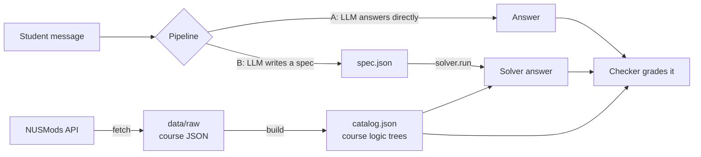
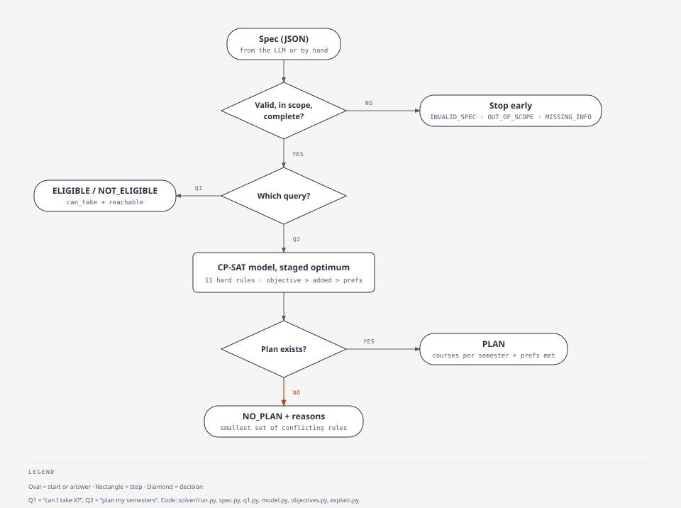
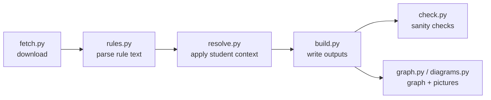

# Code guide: how the repo fits together

Read this first. It explains what each part of the code does and how a request moves through it,
in about 15 minutes. It doesn't list every field or rule. For those, go to:
[`DATA_SCHEMA.md`](DATA_SCHEMA.md) (the data), [`SOLVER_GUIDE.md`](SOLVER_GUIDE.md) (solver input and
output) and [`TRANSLATION_GUIDE.md`](TRANSLATION_GUIDE.md) (turning a student's message into a spec).

## 1. The whole project in one picture



- **`m1_data/`** (M1, done) turns NUSMods into `catalog.json`: for every course, what it needs,
  what it excludes and when it runs, written as small logic trees.
- **`solver/`** (M2, done) reads a **spec**, a small JSON request such as "can I take CS3263?" or
  "plan my remaining semesters". It answers using the catalogue.
- **`instances/`, `pipelines/` and `eval/`** (M3, done) sit around the solver: they produce student
  messages with known answers, run the two LLM pipelines (A and B), and grade every answer.

## 2. Follow one question through the code: "Can I take CS3263?" (Q1)

```json
{"query": "eligible", "target": "CS3263", "current_sem": 5,
 "completed": ["CS1101S", "CS1231S", "CS2030S", "CS2040S", "MA1521", "MA1522", "ST2334", "CS3244"],
 "programme": "BComp CS Hons"}
```

| Step | Code | What happens |
|---|---|---|
| 1 | `solver/run.py` → `run()` | Entry point. Loads the catalogue and calls `prepare()`. |
| 2 | `solver/spec.py` → `validate()` | Checks the spec, upper-cases codes and fills defaults. A broken spec stops here with `INVALID_SPEC`. |
| 3 | `m1_data/scope.py` → `check_scope()` | Not BComp CS Hons, or mentions a DDP, minor or second major? Stops with `OUT_OF_SCOPE`. |
| 4 | `solver/run.py` → `prepare()` | Missing something essential (e.g. no `completed`)? Stops with `MISSING_INFO`. |
| 5 | `solver/q1.py` → `answer()` | Calls `Catalog.can_take("CS3263", completed, semester)`. |
| 6 | `m1_data/catalog.py` → `can_take()` | Checks the prerequisite tree, exclusions, offering term and whether the course is open to this student. Returns `(False, ["missing prerequisite: CS2109S or CS2109HS"])`. |
| 7 | `m1_data/catalog.py` → `reachable()` | Not eligible now, but could they ever be? CS3244 rules out CS2109S, and CS2109HS is closed to CS Hons, so no. |
| 8 | back in `q1.py` | Returns `NOT_ELIGIBLE` with the reasons and `never_eligible_because`. |

Run it yourself: `python -m solver.run examples/q1_eligible.json`.



## 3. Follow one plan request: "Plan my remaining semesters" (Q2)

`examples/q2_plan.json` asks to plan semesters 3–8 with a list of must-take courses, a credit
cap, one blocked semester and some preferences. Steps 1–4 are the same as Q1, then:

| Step | Code | What happens |
|---|---|---|
| 5 | `solver/q2.py` → `answer()` | Builds the model and then optimises in stages (below). |
| 6 | `solver/model.py` → `PlanModel` | Turns the request into a CP-SAT model. There is one yes/no variable per *(course, semester)*. Rules added: each course is offered in that term, prerequisites are done in an earlier semester, mutually exclusive courses are never both taken, credits fit per semester, and must-rules hold. Courses the plan needs but can never reach are caught early by `check_reachable()`. |
| 7 | `q2.py` | **Staged optimisation.** Each stage solves, then locks its best value before the next: (1) the objective, e.g. graduate as early as possible; (2) fewest extra courses; (3) as many "prefer" wishes as possible; (4) if graduating early wasn't already the goal, finish as early as possible. |
| 8a | plan found | `build_answer()` returns `PLAN`: courses per semester, credits, and which wishes were met. |
| 8b | no plan | `solver/explain.py` → `find_conflict()` switches rules on and off, using CP-SAT "assumption" literals, until it finds a **smallest set of rules that cannot all hold**. It returns `NO_PLAN` with those rules in plain words. |

**Own solver for the ablation:** `solver/backtrack.py` solves the same Q2 with a hand-written
backtracking search instead of CP-SAT. It has four variants, each adding one technique from the
course: `plain`, then `mrv` (most-constrained course first), then `fc` (forward checking), then
`mac` (arc consistency). `experiments/run_ablation.py` runs all four plus CP-SAT on the same
instances, and reports time, search nodes and whether they agree.

## 4. Follow one instance through the experiment (M3)

| Step | Code | What happens |
|---|---|---|
| 1 | `instances/generate.py` | Builds a **gold spec** first, renders the student's message from it, and stores the solver's answer to that spec as the **gold answer**. The instance is kept only if the answer has the status its kind was built to have. |
| 2a | `pipelines/run_a.py` + `prompt_a.py` | **Pipeline A.** The LLM gets the planning rules, the catalogue records of the courses involved, and the message. It answers with a status (and a plan). No tool. |
| 2b | `pipelines/run_b.py` + `prompt_b.txt` | **Pipeline B.** The LLM gets only the translation instructions and the message, and writes a spec. `solver.run` answers the spec. |
| 3 | `results/<A or B>/<model>/<id>.json` | One file per instance: the raw reply, the parsed answer (or spec), how the reply had to be repaired, tokens and seconds. |
| 4 | `eval/checker.py` | Checks a plan against the hard rules, read straight from `catalog.json`. It doesn't import the solver, so the two can disagree. |
| 5 | `eval/grade.py` | Puts each answer in one class (optimal, preference gap, extra courses, objective gap, invalid, over-refusal, invented plan, ...) and writes `graded.csv`, `SUMMARY.md` and, for two folders, `COMPARE.md`. |

Try the whole chain without an API key: `python -m pipelines.run_a --mock gold`, then
`python -m eval.grade results/A/mock-gold`. Every answer is the gold answer, so the grade must come out 100%.

The instance files are generated. After a change to the spec format or the solver's rules, run
`python -m instances.generate` (and `generate_q1`) again, otherwise the stored gold specs and answers
go out of date.

## 5. How the catalogue is made (M1)



| Step | File | In plain words |
|---|---|---|
| Download | `fetch.py` | Fetches every CS course, plus everything their prerequisites and exclusions name, from NUSMods. Saves the raw JSON. |
| Parse | `rules.py` | NUSMods writes rules as text like `PROGRAM_TYPES IF_IN Undergraduate Degree THEN COURSES (1) CS2109S:D, CS2109HS:D AND ...`. A small parser turns that into a tree. Nothing is decided yet. |
| Resolve | `resolve.py` | Answers every non-course condition (programme, cohort, A-level subjects) for one student, defined in `data/config/student_context.json`. What's left only mentions courses. Then it simplifies the tree. |
| Build | `build.py` | Writes `catalog.json` and the readable versions. It compares each tree with NUSMods' own `prereqTree` and reports differences in `PARSE_REPORT.md`. |
| Check | `check.py` | Fails the build if anything looks wrong: a tree naming an unknown course, a prerequisite cycle, a one-way exclusion. |
| Use | `catalog.py` | `Catalog.load()`, `can_take()`, `reachable()`. This is what the solver calls. |

**A logic tree** has only four kinds of node, and everything else in the code builds on this:

```
{"op": "and",  "args": [...]}        all of these
{"op": "or",   "args": [...]}        any one of these
{"op": "n_of", "n": 2, "args": [...]} at least 2 of these
{"op": "course", "code": "CS2040S"}  this course is completed
```

## 6. Where everything is

| Path | What it is | Owner |
|---|---|---|
| `m1_data/fetch.py`, `rules.py`, `resolve.py`, `build.py`, `check.py` | Data pipeline (section 5) | M1 |
| `m1_data/catalog.py` | Load the catalogue; `can_take`, `reachable`, `satisfied` | M1 |
| `m1_data/scope.py` | In or out of scope; the standard decline message | M1 |
| `m1_data/graph.py`, `diagrams.py`, `overviews.py`, `docs.py` | Graph exports, diagrams, `COURSES.md` | M1 |
| `solver/run.py` | Entry point for every spec | M2 |
| `planner/__main__.py`, `cli.py`, `formatting.py` | `python -m planner`: interactive Pipeline B interface; specs stay in memory | UI |
| `solver/common.py` | Constants and small helpers shared by both solvers (`term_of`, `LAST_SEM`, ATAP limits) | M2 |
| `solver/spec.py` | Validate and clean a spec | M2 |
| `solver/q1.py` | "Can I take X?" | M2 |
| `solver/model.py`, `q2.py` | CP-SAT model and staged optimisation for plans | M2 |
| `solver/explain.py` | Smallest set of conflicting rules for `NO_PLAN` | M2 |
| `solver/backtrack.py` | Own backtracking solver, four variants | M2 |
| `experiments/run_ablation.py` | CP-SAT vs the four variants | M2 |
| `examples/*.json` | Example specs to run | M2 |
| `data/processed/AY2026-2027/` | Generated data: catalogue, graph, diagrams, report | generated |
| `tests/` | pytest for the data pipeline, the solver, the instance set and the checker | all |
| `instances/generate.py`, `generate_q1.py` | Instance generators; `instances.json` (115 mixed), `q1_400.json`, `q1_gating.json` | M3 |
| `pipelines/run_a.py`, `prompt_a.py` | Pipeline A: the LLM answers directly | M3 |
| `pipelines/run_b.py`, `prompt_b.txt` | Pipeline B: the LLM writes a spec, the solver answers | M3 |
| `pipelines/ablation/` | Prompt ablation 1 for both pipelines | M3 |
| `eval/checker.py`, `grade.py` | Independent plan checker; grading and result tables | M3 |

## 7. Reading order

- **15 minutes:** this file, then open `data/processed/AY2026-2027/diagrams/index.html` and click
  around, then run `python -m solver.run examples/q2_plan.json`.
- **1 hour:** `solver/run.py` (74 lines) → `solver/q1.py` (52) → `m1_data/catalog.py` →
  `solver/model.py` `build()` → `solver/q2.py` `answer()`. You can skip `backtrack.py`
  unless you are writing the ablation section.
- **Presenting or writing the report:** [`FORMULATION.md`](FORMULATION.md) has the full
  formulation on one page. The exact rules are in `SOLVER_GUIDE.md` §4–7 and the data decisions in
  `DATA_SCHEMA.md`.

## 8. Where to change things

| You want to… | Change | Then run |
|---|---|---|
| Fix a wrongly parsed course | `data/manual/overrides.json` (with a reason) or `m1_data/rules.py` / `resolve.py` | `python -m m1_data build` |
| Plan for a different student (cohort, A-levels) | `data/config/student_context.json` | `python -m m1_data build` |
| Add courses to the catalogue | `seed_codes` in `data/config/scope.json` | `python -m m1_data fetch` then `build` |
| Add a new spec field or rule type | `solver/spec.py` (validation), `solver/model.py` (constraint), `eval/checker.py` (the same rule, written independently) and both prompts | `python -m instances.generate`, then `python -m pytest -q` |
| Change what counts as out of scope | `m1_data/scope.py` | `python -m pytest -q` |

Always finish with `ruff check .` (style and likely bugs) and `python -m pytest -q` (the data and
the solver). Both must pass before you push.
