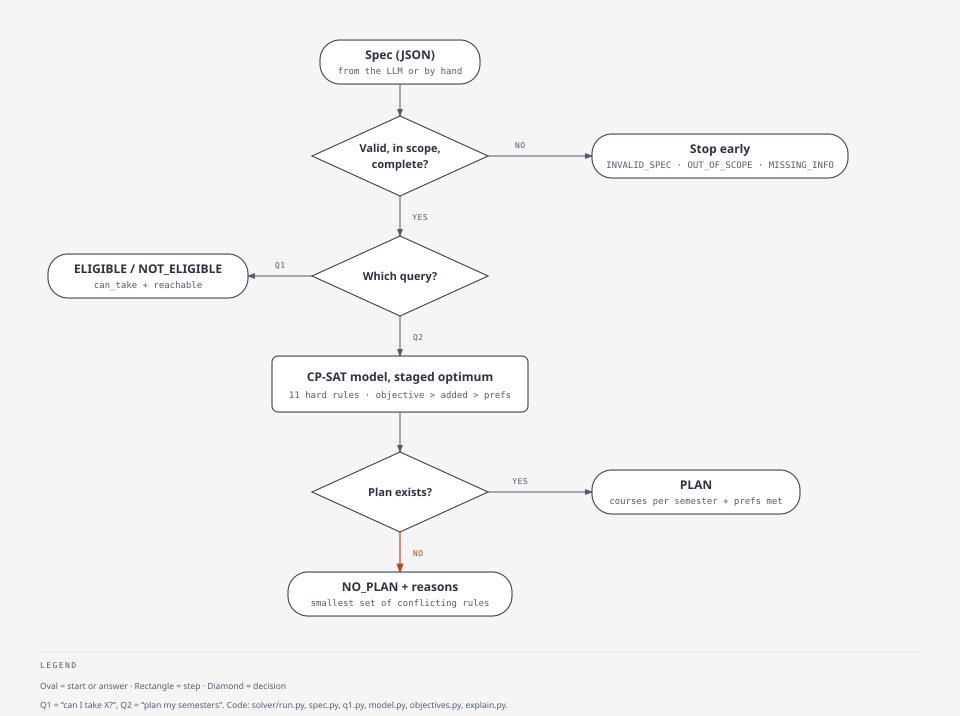

# Problem formulation (presentation and report version)

This is the whole formulation on one page: data (M1) and solver (M2). It's written to be presented
or turned into report §2. The exact rules live in [`SOLVER_GUIDE.md`](SOLVER_GUIDE.md) and
[`DATA_SCHEMA.md`](DATA_SCHEMA.md). If this file and those ever disagree, those win.

## 0. In one paragraph

A BComp (CS) Hons student has completed some courses and has semesters `k…8` left. They ask an
AI assistant either **Q1** "can I take X next semester?" or **Q2** "plan my remaining semesters".
Q1 is **propositional model checking**: evaluate one formula under the student's transcript. Q2 is
a **constraint optimisation problem** solved with CP-SAT: 11 hard rules, a lexicographic objective,
and counted preferences. When no plan exists, the solver returns a **minimal set of conflicting
rules** instead of a plan. We compare an LLM answering directly against the same LLM translating the
request into a JSON **spec** for this solver.

## 1. Inputs

| Input | Where it comes from |
|---|---|
| Course facts: prerequisites, exclusions, offering term, MC | NUSMods AY2026/27, parsed into logic trees (`catalog.json`) |
| The student: completed courses `D`, current semester `k` | the student's message → the spec |
| The request: Q1 target, or Q2 must-take list, MC cap, rules and preferences | the student's message → the spec |

Each prerequisite, corequisite and exclusion is a tree over four node types: `course`, `and`, `or`,
and `n_of` (at least n). Programme, cohort and A-level conditions are worked out beforehand for a
BComp CS Hons student, so the trees mention courses only. Anyone else is answered `OUT_OF_SCOPE`.

## 2. Q1: eligibility as propositional logic

- One proposition per course: `c` is true if `c ∈ D`. The transcript is a truth assignment.
- Prerequisite formula, for example
  `φ_CS3263 = (CS2109S ∨ CS2109HS) ∧ (CS2040 ∨ … ∨ CS2040S) ∧ (MA2001 ∨ MA1522 ∨ …) ∧ (ST2334 ∨ …)`.
- **Eligible(X, term) ⇔ D ⊨ φ_X ∧ ¬β_X ∧ offered(X, term) ∧ open(X)**, where `β_X` is X's exclusion
  formula (e.g. `β_CS3263 = CS3243`).
- Cost: linear in the size of the formula. This is the easy baseline we expect the LLM to handle.
- Extra (`reachable`): could the student *ever* become eligible? It follows prerequisite chains and
  removes every course a completed course rules out. Example: after CS3244, CS3263 is unreachable.

## 3. Q2: planning as a CSP/COP

**Variables.** `x_{c,s} ∈ {0,1}`: course `c` is taken in semester `s ∈ {k,…,8}`.
`planned(c) = Σ_s x_{c,s} ≤ 1`. This is a one-hot form of `sem(c) ∈ {k,…,8, none}`.
The candidate courses are the must-take courses plus everything their unfinished prerequisites
could need.

**Hard rules** (all 11; the numbers match `SOLVER_GUIDE.md` §4):

| # | Rule | Constraint |
|---|---|---|
| 1 | Semesters, at most once, must-take | `planned(c) ≤ 1`; `planned(c) = 1` for every must-take `c ∉ D` |
| 2 | Plannable | `c` exists this AY, is open to CS Hons, and is not ruled out by `D` |
| 3 | Offering | `x_{c,s} = 0` if `c` is not offered in term `1` (odd `s`) or `2` (even `s`) |
| 4 | Prerequisites | `x_{c,s} ⇒ φ_c` with "`p` done" ≡ `p ∈ D ∨ Σ_{t<s} x_{p,t} = 1`; `∧` → all, `∨` → ≥ 1, `n_of` → ≥ n, one reified literal per tree node |
| 5 | Corequisites | the same with `t ≤ s` |
| 6 | Exclusions | `¬planned(a) ∨ ¬planned(b)` for each mutually exclusive pair |
| 7 | MC cap | `Σ_c MC_c · x_{c,s} ≤ cap_s` (default 20; `cap = 0` blocks a semester, e.g. exchange) |
| 8 | Minimum MC | a semester that has courses carries at least `mc_min` MC (if given) |
| 9 | Must rules | `before` (`sem(a) < sem(b)`), `same_sem`, `apart`, `in_sem` (`x_{c,s} = 1`) |
| 10 | No padding | an added course is planned only if a later planned course needs it |
| 11 | ATAP (CP3880, 12 MC) | only in allowed semesters; never the last one used; other courses that semester ≤ min(8, cap); its 12 MC is outside the cap |

**Soft preferences** (counted, never allowed to break a hard rule; `SOLVER_GUIDE.md` §5): `prefer`
versions of the four rules, and a course as early or as late as possible.

**Objective: lexicographic, solved in stages.** Each stage is solved, then its value is fixed before
the next stage:

1. **objective:** graduate earliest (minimise the last semester used), or minimise total MC;
2. **fewest added courses** (courses beyond the must-take list);
3. **most preferences met.**

One tie-break follows (an earlier finish); it isn't graded. Stage 1
always wins, so a later graduation is never traded for more preferences.

## 4. When no plan exists

Six kinds of impossible request, used to build the infeasible test set (`SOLVER_GUIDE.md` §7):

| Kind | Example | Answer comes from |
|---|---|---|
| Exclusion conflict | took CS3244, wants CS3263 | the data (`reachable`) |
| Prerequisite chain too long | CS3263 in semester 8 without CS2109S | minimal conflict |
| MC capacity | 12 MC needed, 8 MC of room | capacity message with both numbers |
| Offering parity | a Sem-1-only course with only Sem 2 left | the data |
| Conflicting rules | three courses forced into one 8 MC semester | minimal conflict |
| Hidden conflict | a rule that places a course before its prerequisites can be done | minimal conflict |

**Minimal conflict** (`solver/explain.py`): every rule group gets an assumption literal. CP-SAT
returns the assumptions it needed to prove infeasibility, and groups are then removed one at a time
while the rest stays infeasible. The result is **sound** (those rules really can't all hold) and
**minimal** (dropping any one makes it solvable). It is one conflict, not necessarily the only one,
so scoring accepts any correct minimal conflict.

## 5. Our own CSP solver (for the ablation)

`solver/backtrack.py` solves Q2 without CP-SAT using branch-and-bound backtracking over the same
stages. It has four cumulative variants: `plain` → `mrv` (most-constrained course first) → `fc`
(forward checking) → `mac` (repeat pruning until nothing changes, which reaches the same fixpoint as
AC-3). All variants must agree with CP-SAT on status, last semester and preferences met; any
disagreement is a bug. The ablation compares nodes, checks and seconds (`SOLVER_GUIDE.md` §9).

## 6. How answers are graded

| Answer | Grading |
|---|---|
| Statuses | Q1: `ELIGIBLE` / `NOT_ELIGIBLE`. Q2: `PLAN` / `NO_PLAN`. Both: `MISSING_INFO`, `INVALID_SPEC`, `OUT_OF_SCOPE` |
| A plan (feasible instance) | exactly one of: **invalid** (breaks a hard rule) → **objective gap** → **extra courses** → **preference gap** → **optimal** |
| Infeasible instance | correct only if it says no plan exists; a plan here is an **invented plan** |
| Feasible instance answered "impossible" | **over-refusal** (the tight-feasible set measures this) |
| Pipeline B's spec | valid JSON, valid spec, per-field match with the gold spec, silent drops of unsupported wishes, same solver answer (`TRANSLATION_GUIDE.md` §7) |
| Out-of-scope request | correct only if declined with a reason |

## 7. Why CSP and not classical planning

As STRIPS, `take(c)` has precondition `φ_c ∧ offered(c, now)` and effect `completed(c)`.
Nothing is ever undone, so the domain has almost no delete effects, and plan existence without
deletes is easy (the ignore-delete-lists heuristic is nearly exact here). Only exclusions
(negative preconditions) and MC caps break this, and they are exactly what the infeasible set
targets. MC caps are also awkward in PDDL without numeric fluents. That's the argument for CSP.

## 8. What is deliberately not modelled

- Future offerings are assumed to match AY2026/27, with no timetable clashes and no failed courses.
- Every planned course is assumed to be obtained. Section 9 drops this assumption.
- No waivers or appeals: "impossible" means impossible under the stated rules and the data, and an
  advisor can still decide otherwise.
- Degree requirements are supplied as a must-take list, not derived from the programme rules.
- Students outside BComp CS Hons single major (DDP, second major, minor, other programmes) are
  `OUT_OF_SCOPE`.

## 9. Extension: bidding as an MDP

A CourseReg bid can fail, so the plan of section 3 may not be executable. `solver/mdp.py` treats the courses
CP-SAT chose as a finite-horizon MDP ([`MDP_GUIDE.md`](MDP_GUIDE.md)):

- **State** `(s, G)`: the semester and the set of courses obtained so far.
- **Action**: a set of courses to bid for that respects the offering, prerequisite, corequisite, exclusion
  and MC-cap rules in semester `s`.
- **Transition**: each course in the bid is obtained independently with probability `p(c, term)`, estimated
  from two years of CourseReg demand and allocation reports.
- **Cost**: 1 per semester until every `must_take` course is obtained, plus a penalty if that has not
  happened by semester 8.
- **Solution**: `V(s, G) = min_a [1 + Σ P(G' | G, a) V(s+1, G')]` by backward induction. The answer is a
  policy.

With `p = 1` everywhere the MDP is the CSP: its value is the CP-SAT last semester (tested on all 45 requests
that have a plan). The extension is separate from pipelines A and B and from the grading.
